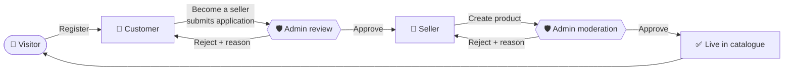

<div align="center">

# 🛍️ ShopIt

### A full-stack, multi-vendor e-commerce marketplace with role-based access control

**Customers shop. Sellers list. Admins govern.** Three roles, one secure platform.

<br/>

[](https://shop-it-flax.vercel.app/)

[](https://nextjs.org/)
[](https://react.dev/)
[](https://www.typescriptlang.org/)
[](https://www.mongodb.com/)
[](https://tailwindcss.com/)
[](https://www.selenium.dev/)
[](https://github.com/Pushkaraj-Palli/ShopIt/stargazers)
[](https://github.com/Pushkaraj-Palli/ShopIt/fork)

<br/>


</div>

---

## ✨ Why ShopIt?

Most portfolio shops stop at "a grid of products and a cart." **ShopIt goes further and models how a real marketplace works:**

- 🔐 **Real access control.** Customers, sellers and admins each see different things, and the server enforces it, not just the UI.
- 🏪 **A seller pipeline.** Apply → admin review → approval → a personal seller workspace to list products, set prices and manage stock.
- 🛡️ **Moderated catalogue.** New listings wait for admin approval, and rejections come with a reason the seller can act on.
- 🧪 **50 automated browser tests.** A Selenium suite checks sign-in, permissions, products, cart and admin flows.

> Built to show end-to-end engineering: data modelling, authentication, authorization, validation, testing and UI, in one codebase.

---

## 📸 Screenshots

### Seller and admin experience

<table>
  <tr>
    <td width="50%" align="center">
      
      <br/><b>📦 Product dashboard</b>
    </td>
    <td width="50%" align="center">
      
      <br/><b>📝 Seller application</b>
    </td>
  </tr>
  <tr>
    <td colspan="2" align="center">
      
      <br/><b>🏪 Seller workspace</b>
    </td>
  </tr>
</table>

### Storefront

<table>
  <tr>
    <td width="50%"><br/><div align="center"><b>Browse & filter</b></div></td>
    <td width="50%"><br/><div align="center"><b>Product details</b></div></td>
  </tr>
  <tr>
    <td colspan="2" align="center"><br/><b>Cart & checkout</b></td>
  </tr>
</table>

---

## 🧭 Table of Contents

- [How it works](#-how-it-works)
- [Features](#-features)
- [Security by design](#-security-by-design)
- [Tech stack](#-tech-stack)
- [Quick start](#-quick-start)
- [Automated testing](#-automated-testing-with-selenium)
- [Project structure](#-project-structure)
- [Roadmap](#-roadmap)
- [Contributing](#-contributing)
- [About the author](#-about-the-author)

---

## 🔄 How it works



| Role | What they can do |
|---|---|
| 👤 **Guest** | Browse and search the catalogue, view product pages |
| 🛒 **Customer** | Everything above, plus cart, wishlist, checkout, and applying to become a seller |
| 🏪 **Seller** | Manage **only their own** products: pricing, stock, variants, and review status |
| 🛡️ **Admin** | Approve or reject seller applications and product listings, with reasons |

> Public sign-up always creates a **customer**. Nobody can pick "admin" or "seller" on the form. Sellers are approved, and the first admin comes from a seed script.

---

## 🚀 Features

### 🛍️ For shoppers
- Browse by **categories**, with product search and filters
- Rich **product detail** pages with images and descriptions
- **Cart** with add, remove and quantity management
- **Wishlist** to save products for later
- Responsive layout, **dark / light theme**, and smooth **Framer Motion** animations

### 🏪 For sellers
- **"Become a seller"** application: store name, contact, address, tax ID
- Application status tracking, with **resubmission** after a rejection
- **Product management** (create, edit, view) with:
  - Name, description, category and subcategory, brand, SKU, tags
  - Price (INR), **compare-at price**, images
  - **Stock quantity**, **low-stock threshold**, inventory tracking, backorder toggle
  - **Variants** (size, colour and so on), each with its own SKU, price and stock
- Listings are submitted for review and tracked through `pending → active / rejected`

### 🛡️ For admins
- **Seller applications** queue at `/admin/retailers`: approve, or reject with a reason
- **Product moderation** at `/admin/products`: approve to publish, or reject with feedback to the seller
- Only `active` products appear in the public catalogue

---

## 🔒 Security by design

| Layer | What it does |
|---|---|
| **Edge middleware** | Verifies the signed JWT session cookie (HS256) and gates `/seller`, `/admin`, `/account`, `/checkout` by role |
| **Central permission map** | One `lib/auth/permissions.ts` policy shared by UI and API routes |
| **Server-side guards** | Seller and admin API routes check the role again, so hiding a button is never the only protection |
| **Ownership checks** | A seller can only read or modify products where `sellerId` matches their own account |
| **Validated input** | Zod schemas on product and application payloads |
| **Safe passwords** | `bcryptjs` hashing, and the seeded admin password must be at least 12 characters |
| **Money as integers** | Price fields are stored as whole numbers (paise) to avoid floating-point errors |

---

## 🧰 Tech stack

| Area | Technologies |
|---|---|
| **Frontend** | Next.js 14 (App Router), React 18, TypeScript, Tailwind CSS, Radix UI, shadcn/ui, Framer Motion, Lucide icons |
| **Forms & validation** | React Hook Form, Zod |
| **Backend** | Next.js API routes, Express server, JWT authentication |
| **Database** | MongoDB with Mongoose |
| **Payments** | Stripe (SDK integrated) |
| **Testing** | Selenium WebDriver, Mocha, Chai, Mochawesome (Page Object Model) |
| **Tooling** | ESLint, Concurrently, cross-env |

---

## ⚡ Quick start

**Prerequisites:** Node.js 18+ and a MongoDB instance (local or [Atlas](https://www.mongodb.com/atlas)).

```bash
# 1. Clone
git clone https://github.com/Pushkaraj-Palli/ShopIt.git
cd ShopIt

# 2. Install
npm install

# 3. Configure environment
cp .env.example .env.local
```

Edit `.env.local`:

```env
MONGODB_URI=mongodb://127.0.0.1:27017/shopit
JWT_SECRET=replace-with-a-long-random-secret
ADMIN_NAME=ShopIt Admin
ADMIN_EMAIL=admin@example.com
ADMIN_PASSWORD=choose-a-unique-password-12+-chars
```

```bash
# 4. Add demo products
node scripts/seed.js

# 5. Create your admin account
npm run seed:admin

# 6. Run it
npm run dev
```

Open **http://localhost:3000** 🎉

### Try the full seller journey

1. **Register** a new account at `/account/register` (you start as a customer).
2. Open **Become a seller** and submit the application.
3. Log in as the **admin** you seeded and approve it at `/admin/retailers`.
4. Log in again as the new seller and add a product at `/seller/products`.
5. As admin, approve the product at `/admin/products`. It now appears in the shop. ✅

> Existing products from an older version of the app? Run `npm run migrate:products` to bring them to the marketplace schema.

<details>
<summary><b>📜 All npm scripts</b></summary>

| Script | Description |
|---|---|
| `npm run dev` | Start the Next.js dev server |
| `npm run dev:full` | Run the frontend and Express server together |
| `npm run build` / `npm start` | Production build and server |
| `npm run lint` | Lint the codebase |
| `npm run seed:admin` | Create (or promote) the admin from `.env.local` |
| `npm run migrate:products` | Migrate legacy products to the marketplace schema |
| `npm run e2e:seed` | Seed the **test** database |
| `npm run test:e2e` | Full Selenium suite |
| `npm run test:e2e:smoke` | Fast smoke tests |
| `npm run test:e2e:headed` | Run the suite with a visible browser |

</details>

---

## 🧪 Automated testing with Selenium

ShopIt ships with an end-to-end browser test suite: **8 spec files and 50 test cases** written in TypeScript with the **Page Object Model**.

| Spec | Covers |
|---|---|
| `smoke` | Home, product page and login render |
| `auth` | Register, login, logout, wrong credentials, protected redirects |
| `rbac` | Customers, sellers and guests blocked from areas they shouldn't reach |
| `catalogue` | Search, filters, sorting, product details |
| `retailer-products` | Seller product create, edit and validation |
| `cart-checkout` | Cart and checkout flows |
| `orders-fulfilment` | Order flow |
| `admin` | Admin moderation and user actions |

```bash
npm run e2e:seed          # seed the test DB (refuses to run unless the DB name contains "test")
npm run test:e2e:smoke    # < 2 minutes
npm run test:e2e          # full suite, HTML report in mochawesome-report/
npm run test:e2e:headed   # watch the browser do the work
```

Failures save screenshots to `reports/screenshots/`.

---

## 🗂️ Project structure

```
ShopIt/
├── app/
│   ├── admin/            # Admin console: seller applications, product moderation
│   ├── seller/           # Seller workspace: dashboard, product CRUD
│   ├── become-a-seller/  # Seller application form
│   ├── account/          # Login & registration
│   ├── shop/ categories/ product/ cart/ wishlist/   # Storefront
│   ├── api/              # REST routes: auth, products, cart, wishlist, orders, admin, seller
│   ├── models/           # Mongoose: User, Product, SellerProfile, Order, Cart, Wishlist, Category
│   └── lib/              # DB connection, auth helpers, validation schemas
├── components/           # UI: layout, product, seller, shadcn/ui primitives
├── lib/auth/permissions.ts   # Role → permission policy (single source of truth)
├── middleware.ts         # JWT verification + route gating at the edge
├── scripts/              # seed, seed-admin, migrate-products
├── server/               # Express server
└── tests/e2e/            # Selenium: config, pages (POM), helpers, specs
```

---

## 🗺️ Roadmap

- [x] JWT authentication with role-based access (customer / seller / admin)
- [x] Seller application and admin approval workflow
- [x] Seller product management with variants and stock
- [x] Admin product moderation with rejection reasons
- [x] Selenium end-to-end test suite
- [ ] Seller order fulfilment and tracking
- [ ] Product image uploads (Cloudinary)
- [ ] Reviews and ratings (verified purchase)
- [ ] Seller analytics and payouts
- [ ] Email notifications
- [ ] CI pipeline running the Selenium suite

Have an idea? [Open an issue](https://github.com/Pushkaraj-Palli/ShopIt/issues).

---

## 🤝 Contributing

Contributions are welcome!

1. **Fork** the repo
2. Create a branch: `git checkout -b feature/amazing-feature`
3. Commit: `git commit -m "Add amazing feature"`
4. Push and open a **Pull Request**

---

## 👨‍💻 About the author

**Pushkaraj Palli**, a final-year Electronics & Telecommunication engineering student with a software development background. Author of an **IEEE-published paper** on *VocalEyes*, an AI-powered assistive Android app for the visually impaired, which won **Best Paper at ICCUBEA 2025**.

📫 Reach me through [GitHub](https://github.com/Pushkaraj-Palli) or by [opening an issue](https://github.com/Pushkaraj-Palli/ShopIt/issues).

---

<div align="center">

### ⭐ If ShopIt helped or impressed you, give it a star!

**[👁️ Watch](https://github.com/Pushkaraj-Palli/ShopIt/subscription)** for updates · **[🍴 Fork](https://github.com/Pushkaraj-Palli/ShopIt/fork)** to build on it · **[🚀 Live demo](https://shop-it-flax.vercel.app/)**

Made with ❤️ by [Pushkaraj Palli](https://github.com/Pushkaraj-Palli)

</div>
